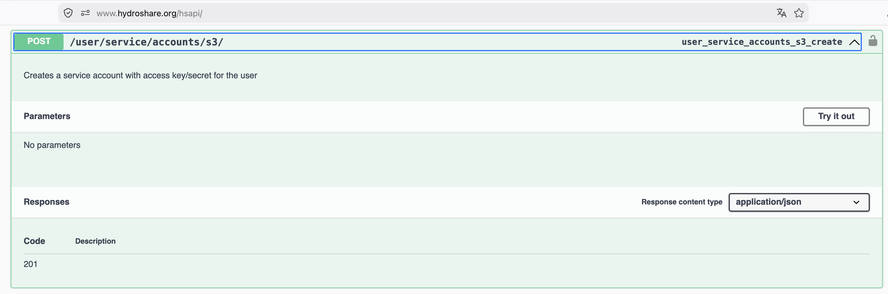

# CIROH HydroFabric DVC Integration

This project uses [DVC (Data Version Control)](https://dvc.org/) to manage data pipelines and track changes to large datasets. DVC enables reproducible workflows and seamless collaboration.

## Hydrofabric Viewer

The Hydrofabric Viewer is a browser app for exploring hydrofabrics stored in HydroShare and downloading the network upstream of any point. It is available at:

**<https://cuahsi.github.io/ciroh-hydrofabrics/subset.html>**

Use the full `subset.html` address. The site root has no landing page and returns a 404.

### Using the viewer

1. Select **Sign in** and log in with your HydroShare account. The viewer reads hydrofabric data directly from HydroShare S3 storage, which requires your HydroShare credentials.
2. Choose a hydrofabric with the **Resource ID** selector, or select **Custom…** and enter the ID of any HydroShare resource that contains a hydrofabric. You can also link to a resource directly with the `resource_id` query parameter, for example `subset.html?resource_id=e280863b7c31415f880432764c5b8eb1`.
3. Use the **Layers** panel to show or hide divides, flowpaths, and nexus points. Turn on **Split View** to compare two hydrofabrics side by side, such as the researcher's data and the Community Hydrofabric.
4. Click a nexus point on the map to select it as the outlet. The viewer finds every catchment upstream of it.
5. Select **Subset & Download** to save the upstream network as a GeoPackage named `<nexus-id>_subset.gpkg`. It contains the divides, flowpaths, nexus, points of interest, hydrolocations, and lakes layers, plus their attribute tables.

### Deployment

The viewer's source lives in `subsetter/`. It has no build step: the [`deploy_pages.yaml`](.github/workflows/deploy_pages.yaml) workflow publishes the `subsetter/` folder to GitHub Pages as is, whenever a push to `main` changes a file under `subsetter/` or the workflow itself. To redeploy without a code change, run the workflow manually from the repository's **Actions** tab.

## Consistency Checks

Check one Build's GeoPackages locally or from a public HydroShare resource with
`pixi run consistency-check <target>`. For a single local file, also provide
`--type ngen|reference --vpu <VPU>`; its filename can be arbitrary. For a
multi-VPU GeoPackage, the checks select only that VPU's rows before recording
counts. Checks currently run in advisory mode. The v2.2 attribute check applies rules from the
[v2.2 specifications](validation/consistency/models/v2.2/README.md) and reports
violations, invalid numeric values, sentinel candidates, and indeterminate or
unchecked cases. Its bounds are validation assumptions, not universal physical
limits. Missing rule prerequisites are reported separately and should be reviewed
with the schema results.

Geometry overlap reporting uses the configurable `geometry.overlap_min_area_m2`
setting in `validation/consistency/checks.yaml` (default 100 m²). Older custom
check configurations must add an `attributes.blocking` boolean, for example
`false` to keep the check advisory. See [Consistency Checks](validation/consistency/README.md)
for the attribute metrics, migration example, runner, and limits.

## DVC Installation

To use this project, you must have [DVC](https://dvc.org/doc/install) installed. The recommended way is via pip:

```sh
pip install dvc-s3
```

For more installation options, see the [official DVC documentation](https://dvc.org/doc/install).

## Data

The pipeline relies on several key input datasets, organized in the `ngen-workflow/data/superconus` and `ngen-workflow/data/NHDSnapshot` directories and stored in a [HydroShare resource](https://www.hydroshare.org/resource/7056bc5d6de14c5e9fbece9735124ca1/):

### ngen-workflow/data/superconus

- **divides/**: Parquet files containing catchment divide geometries for each VPU (e.g., `vpuid_01.parquet`).
- **flowpaths/**: Parquet files with flowpath (stream/river) geometries for each VPU.
- **hydrolocations/**: Parquet files with hydrologic location points (e.g., gages, outlets) for each VPU.
- **network/**: Parquet files describing the hydrologic network topology for each VPU.
- **pois.parquet**: Parquet file with points of interest (POIs) across the superCONUS domain.
- **reference_hydrofabric.gpkg**: GeoPackage containing the reference hydrofabric for the superCONUS domain.

### ngen-workflow/data/NHDSnapshot

- **FAC/**: Flow Accumulation (FAC) raster files (`*.tif`) for each region, used in hydrologic refactoring.
- **FDR/**: Flow Direction (FDR) raster files (`*.tif`) for each region, used in hydrologic refactoring.

Each subdirectory contains files for multiple regions or VPUs, typically named by region code (e.g., `01a_fac.tif`, `vpuid_01.parquet`). These datasets are tracked with DVC and may require pulling from remote storage before running the pipeline.

### HydroShare S3 credentials

For DVC to access the input files on HydroShare, configure your AWS credentials with a profile named `hydroshare`:

1. Install the AWS CLI if not already installed.
    ```sh
    pip install awscli
    ```
2. Get an access token and key from HydroShare (POST to https://www.hydroshare.org/hsapi/user/service/accounts/s3/ with basic authentication, use the [Swagger page](https://www.hydroshare.org/hsapi/) to do this easily)

3. Run the following command and enter your credentials:
    ```sh
    aws configure --profile hydroshare
    ```
4. Setup the endpoint url to point to HydroShare
    ```sh
    aws configure set profile.hydroshare.endpoint_url https://s3.hydroshare.org
    ```
### Download Data

You can also download specific files manually with:

```sh
dvc update <path_to_file.dvc>
```

### DVC repro

You can reproduce the demo/devcon pipeline with:

```sh
dvc repro pipelines/demo/devcon/dvc.yaml
```

This will execute all stages in [pipelines/demo/devcon/dvc.yaml](pipelines/demo/devcon/dvc.yaml) in dependency order, rebuilding outputs as needed. If required inputs are missing, DVC will try to pull them from the configured remote.

To rerun only one stage without recursively reproducing upstream stages:

```sh
dvc repro -s pipelines/demo/devcon/dvc.yaml:<stage_name>
```

Example:

```sh
dvc repro -s pipelines/demo/devcon/dvc.yaml:reconcile
```

### Pipeline Parameters

Parameters for the devcon pipeline are defined in [pipelines/demo/devcon/params.yaml](pipelines/demo/devcon/params.yaml):

- `ngen_workflow_dir_relative_input_geopackage`: Input reference hydrofabric geopackage path relative to [ngen-workflow](ngen-workflow).
- `vpuid`: VPU code used to select FAC/FDR/DEM inputs.
- `output_folder`: Output directory root under [ngen-workflow/output](ngen-workflow/output).

#### refactor
- `split_flines_meters`: Split flowlines at this length (meters)
- `collapse_flines_meters`: Collapse flowlines below this length (meters)
- `collapse_flines_main_meters`: Collapse main flowlines below this length (meters)
- `simplify_tolerance_meters`: Simplification tolerance (meters)

#### aggregate
- `ideal_size_sqkm`: Ideal catchment size (sq km)
- `min_length_km`: Minimum flowpath length (km)
- `min_area_sqkm`: Minimum catchment area (sq km)

You can modify these values in [pipelines/demo/devcon/params.yaml](pipelines/demo/devcon/params.yaml). To print current values:

```sh
cat pipelines/demo/devcon/params.yaml
```

## DVC Pipeline Stages

The devcon pipeline stages are defined in [pipelines/demo/devcon/dvc.yaml](pipelines/demo/devcon/dvc.yaml).

Each stage is run in a containerized environment using Docker Compose, and all dependencies and outputs are tracked by DVC for reproducibility.

### 1. reference_corrections
Applies topology corrections to the input hydrofabric.
Output: ngen-workflow/output/${output_folder}/corrections/reference_hydrofabric_fixed.gpkg.

### 2. build_fac_vrt
Builds a FAC VRT mosaic for the selected VPU.
Output: ngen-workflow/output/${output_folder}/NHDSnapshot/FAC_vrt/fac.vrt.

### 3. build_fdr_vrt
Builds an FDR VRT mosaic for the selected VPU.
Output: ngen-workflow/output/${output_folder}/NHDSnapshot/FDR_vrt/fdr.vrt.

### 4. refactor
Refactors hydrofabric flowlines with FAC/FDR rasters and refactor parameters.
Output: ngen-workflow/output/${output_folder}/refactored_reference_hydrofabric.gpkg.

### 5. aggregate
Aggregates refactored catchments using the aggregate parameter thresholds.
Outputs:
- ngen-workflow/output/${output_folder}/aggregate_outlets.gpkg
- ngen-workflow/output/${output_folder}/aggregate_distribution.gpkg

### 6. hfngen
Builds the ngen hydrofabric from aggregate distribution and refactored hydrofabric.
Output: ngen-workflow/output/${output_folder}/ngen_hydrofabric.gpkg.

### 7. minimal_attributes
Adds required minimal attributes from gridded and tabular sources.
Output: ngen-workflow/output/${output_folder}/ngen_hydrofabric_with_atts.gpkg.

### 8. vaa
Computes and appends value-added attributes (terrain, soil, and related variables).
Output: ngen-workflow/output/${output_folder}/ngen_hydrofabric_vaa.gpkg.

### 9. reconcile
Reconciles hydrofabric attributes and writes the final devcon hydrofabric.
Output: ngen-workflow/output/${output_folder}/ngen_hydrofabric_reconciled.gpkg.

## Devcon Run Outputs

For the default params (`output_folder: demo/devcon`), a successful run creates outputs under `ngen-workflow/output/demo/devcon`.

Key outputs:

- ngen-workflow/output/demo/devcon/corrections/reference_hydrofabric_fixed.gpkg
- ngen-workflow/output/demo/devcon/NHDSnapshot/FAC_vrt/fac.vrt
- ngen-workflow/output/demo/devcon/NHDSnapshot/FDR_vrt/fdr.vrt
- ngen-workflow/output/demo/devcon/refactored_reference_hydrofabric.gpkg
- ngen-workflow/output/demo/devcon/aggregate_outlets.gpkg
- ngen-workflow/output/demo/devcon/aggregate_distribution.gpkg
- ngen-workflow/output/demo/devcon/ngen_hydrofabric.gpkg
- ngen-workflow/output/demo/devcon/ngen_hydrofabric_with_atts.gpkg
- ngen-workflow/output/demo/devcon/ngen_hydrofabric_vaa.gpkg
- ngen-workflow/output/demo/devcon/ngen_hydrofabric_reconciled.gpkg

## DVC Metadata After A Pipeline Run

After running a pipeline (for example with `dvc repro pipelines/demo/devcon/dvc.yaml`), DVC tracks files by checksums in two places:

1. `.dvc` files for file-tracked artifacts.
2. The pipeline lock file generated by DVC for stage-tracked artifacts.

### `.dvc` Files

In this repository, a typical `.dvc` file looks like [ngen-workflow/data/superconus/pois.parquet.dvc](ngen-workflow/data/superconus/pois.parquet.dvc):

```yaml
md5: 8b551ff420951325001313aa3f83a26e
deps:
- etag: 2578ead006906994bf60682136bc5c00-1
    size: 310951
    hash: md5
    path: remote://v2.3/pois.parquet
outs:
- hash: md5
    path: pois.parquet
```

What to look for:

- Top-level `md5`: checksum of the `.dvc` metadata definition itself.
- `deps` checksums (`etag` or hash): identity of the source object pulled from remote storage.
- `outs` hash type (`hash: md5`): checksum algorithm DVC uses for the output object in cache/remote.

### Lock File Checksums (`dvc.lock`)

After a successful pipeline run, DVC writes/updates a lock file in the pipeline directory. That file records resolved dependency and output checksums for each stage that ran.

Typical fields to inspect in the lock file:

- Stage-level signature (often `md5`) for the stage definition.
- `deps`: resolved hashes/sizes for stage inputs.
- `outs`: resolved hashes/sizes for stage outputs.

Practical check after a run:

```sh
dvc status
```

- `dvc status` verifies whether workspace files still match recorded checksums.

If you need to inspect tracked metadata directly:

```sh
find . -name "*.dvc"
find . -name "dvc.lock"
```

## Adding Your Own DVC Remote

To use your own remote storage (such as S3, Azure, GCP, or a local directory) for DVC data, you can add and configure a DVC remote as follows:

Using a shared DVC remote is important for collaboration: git commits only store lightweight metadata (`.dvc` and `dvc.lock`), while the actual large artifacts live in remote object storage. With a remote configured, collaborators can pull exactly the data version referenced by a commit, reproduce results consistently, and avoid copying large files manually.

Typical collaborator update flow:

```sh
git pull
dvc pull
```

1. **Add a new remote:**
    ```sh
    dvc remote add -d myremote <remote_url>
    ```
    Replace `myremote` with a name for your remote, and `<remote_url>` with the appropriate URL (e.g., `s3://my-bucket/path`, `azure://container/path`, `gdrive://folderid`, or a local path).

2. **Configure credentials and options:**
    If you are using a HydroShare resource, you should already have credentials stored.

    For other remotes, see the [DVC remote documentation](https://dvc.org/doc/command-reference/remote/modify) for available options.

3. **Verify your remote:**
    ```sh
    dvc remote list
    dvc remote status
    ```

4. **Push or pull data:**
    ```sh
    dvc push
    dvc pull
    ```

5. **After a pipeline run, commit checksum metadata to git and push data to the DVC remote:**

    Run your pipeline first:
    ```sh
    dvc repro pipelines/demo/devcon/dvc.yaml
    ```

    Review changed DVC metadata files (`.dvc` and `dvc.lock`):
    ```sh
    git status --short
    ```

    Stage and commit the updated checksums and pipeline metadata:
    ```sh
    git add <changed .dvc files> <changed dvc.lock files> <changed dvc.yaml/params files>
    git commit -m "Update DVC checksums after pipeline run"
    ```

    Upload data artifacts to the configured DVC remote, then push git metadata:
    ```sh
    dvc push
    git push
    ```

    Recommended order is `dvc push` before `git push` so collaborators can pull data referenced by the new commit immediately.

You can add multiple remotes and switch the default with:
```sh
dvc remote default myremote
```

For more details, see the [official DVC documentation on remotes](https://dvc.org/doc/command-reference/remote).
